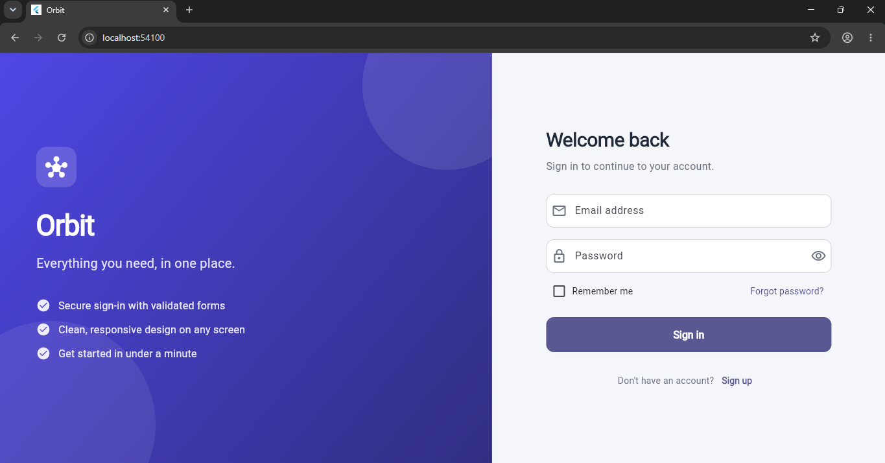
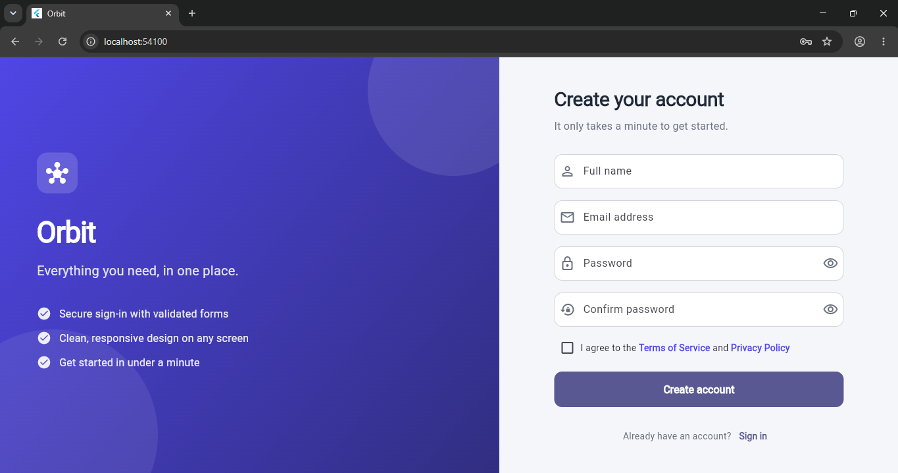

# Orbit: Login and Register (Flutter)

A Flutter login and register app with form validation, a password-strength bar and a responsive layout. Built by Travis, Bingham University.

## Screenshots

  

  

  

## Run it

    flutter pub get
    flutter run -d chrome

## Notes

Accounts are stored in memory only (no real backend), so they reset when the app restarts.